# Hoja de vida web · Johyner Martinez
 
 <!-- R15 descripcion corta de mi pagina con el enlace de la misma -->

Sitio personal con mi hoja de vida, mis proyectos y algunas cosas que me gustan. Está hecho solo con HTML y CSS, con diseño responsive: se ve bien en celular, tablet y computador.

enlace de la pagina web: https://johynerm.github.io/Hoja_de_vida/

## CONTENIDO
- [Páginas](#páginas)
- [Mockups](#mockups)
- [Breakpoints](#breakpoints)
- [Visualización de la página en celular y PC](#visualización-de-la-página-en-celular-y-pc)
- [Cómo lo publiqué](#cómo-lo-publiqué)
- [Fuentes consultadas](#fuentes-consultadas)

## Páginas
 
| Página | Archivo | Qué contiene |
|---|---|---|
| Inicio | `index.html` | Hoja de vida: perfil, habilidades, contacto y redes |
| Proyectos | `proyectos.html` | Mis proyectos: LaCueva, Gimnasio ForceTech y Organizador de horario |
| Más sobre mí | `personalidad.html` | Mis gustos, datos curiosos con animaciones CSS y mi historia de aprendizaje |
 
Las tres páginas comparten el mismo menú de navegación y un único archivo de estilos: `style.css`.

## Mockups
 
 <!-- R16 Todos los mockups estan en esta seccion -->

Cada mockup tiene marcadas las áreas del grid (`grid-template-areas`) y explica en qué ancho cambia el diseño.

- Presentare primero los Mockups para las **versiones de celular** ya que esta pagina tiene una orientacion de **MobileFirst**

```
--->Inicio (la estructura de index.html )
```

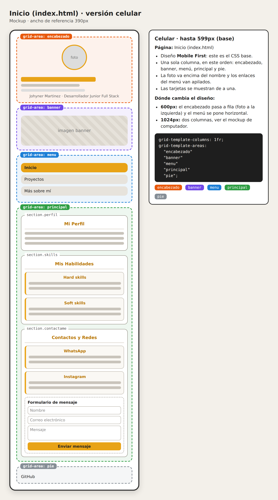

```
--->Mis Proyectos (la estructura de proyectos.html )
```

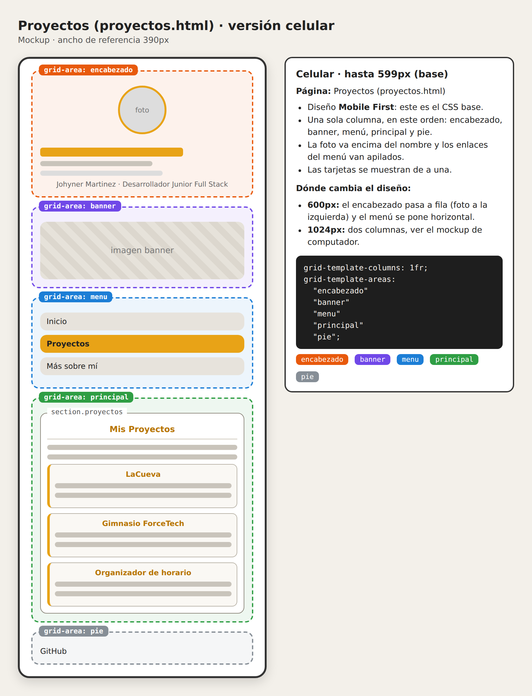
```
--->Sobre mi (la estructura de personalidad.html )
```

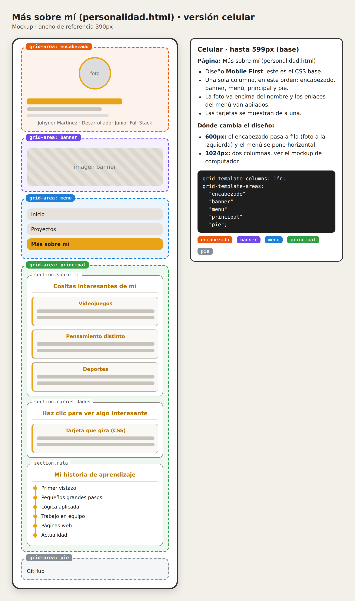

- Ahora la parte de los Mockups **en version de PC o laptop**.

```
--->Inicio (la estructura de index.html )
```

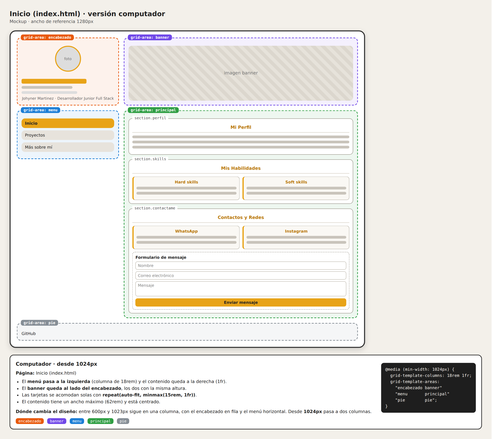
```
--->Mis Proyectos (la estructura de proyectos.html )
```

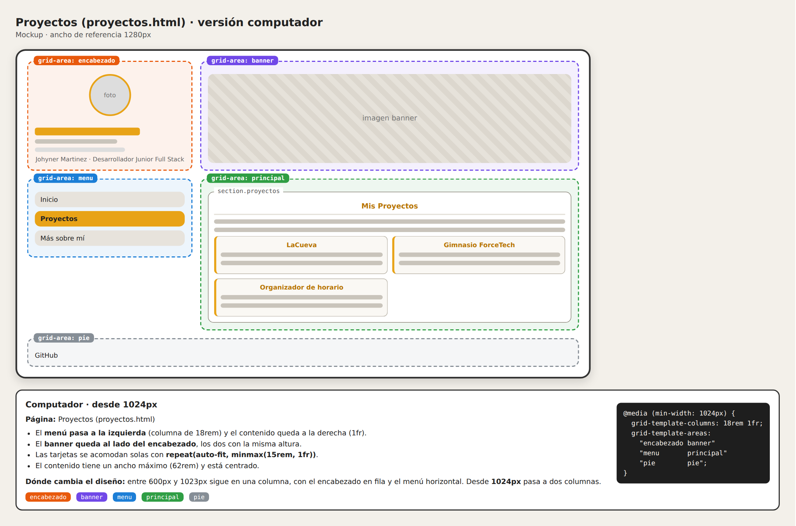
```
--->Sobre mi (la estructura de personalidad.html )
```

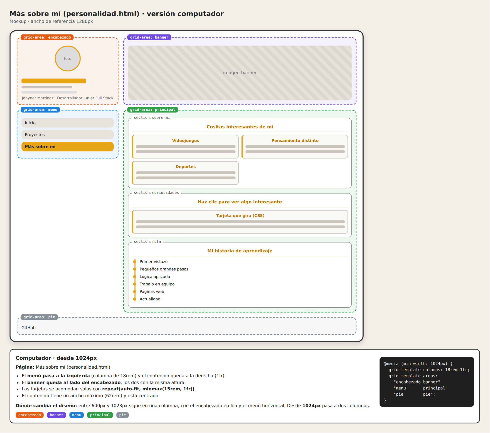

## Breakpoints
 
<!-- R18 explicaciones -->

El diseño es **Mobile First**: el CSS base es para celular y las `@media (min-width: …)` van al final del archivo, de menor a mayor.
 
- **Base (celular, menos de 600px):** todo en una sola columna. El orden es encabezado, banner, menú, contenido y pie. La foto de perfil va encima del nombre, el menú tiene los enlaces apilados y las tarjetas se muestran de a una.
- **Desde 600px (tablet):** el encabezado pasa a columna, con la foto a la izquierda del texto. El menú se vuelve horizontal, el banner y el título crecen, hay más espacio interior y el botón del formulario deja de ocupar todo el ancho.
- **Desde 1024px (computador):** el grid pasa a dos columnas (`18rem 1fr`) con estas áreas:
```css
  grid-template-areas:
      "encabezado banner"
      "menu       principal"
      "pie        pie";
```
 
  El menú queda a la izquierda y se mantiene visible al bajar (`position: sticky`). El encabezado y el banner quedan lado a lado, con la misma altura, y el contenido ocupa la columna derecha.
 
Además, las tarjetas usan `repeat(auto-fit, minmax(15rem, 1fr))`, así que se acomodan solas según el espacio disponible. El contenido tiene un ancho máximo de `62rem` y está centrado.

## Visualización de la página en celular y PC

<!-- R17 en celular y en PC -->

Observemos algunos pequeños adelantos de como se visualiza la pagina en los distintos dispositivos
```
En móviles tenemos los diferentes apartados de la siguiente manera:
```
### **Inicio**


### **Mis Proyectos**


### **Sobre Mi**


```
Para las pantallas más grandes como los PCs o laptops podemos verlo de la siguiente manera
```
### **Inicio**

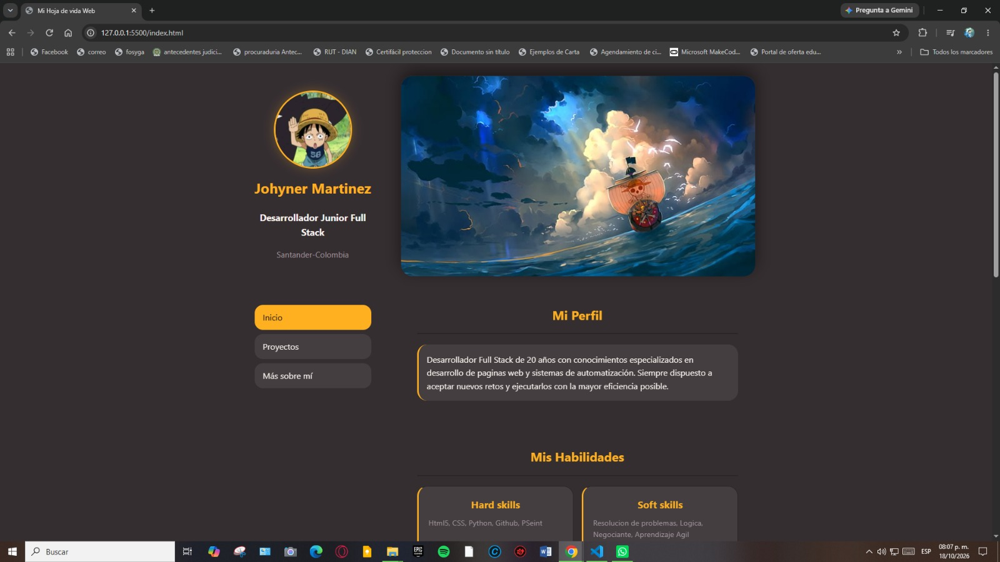
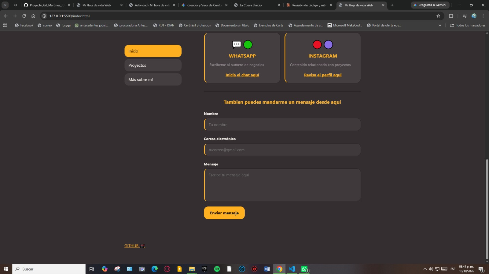

### **Mis Proyectos**

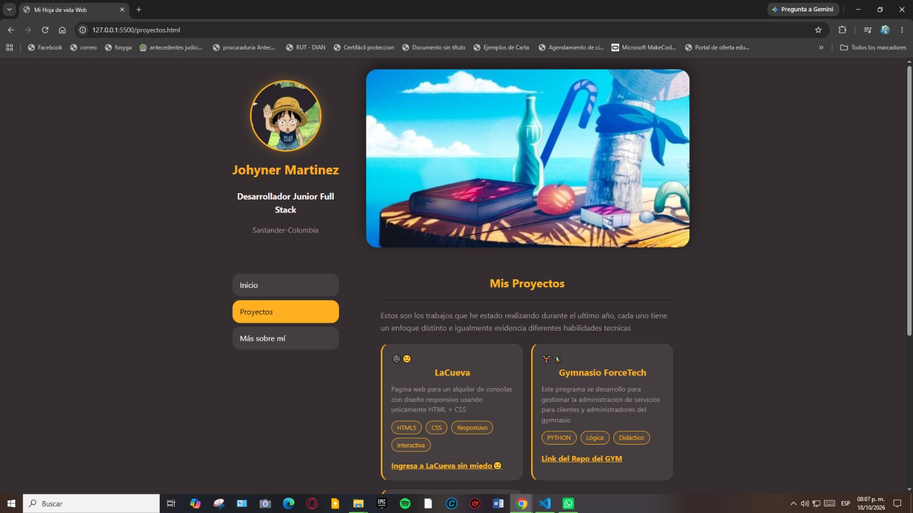
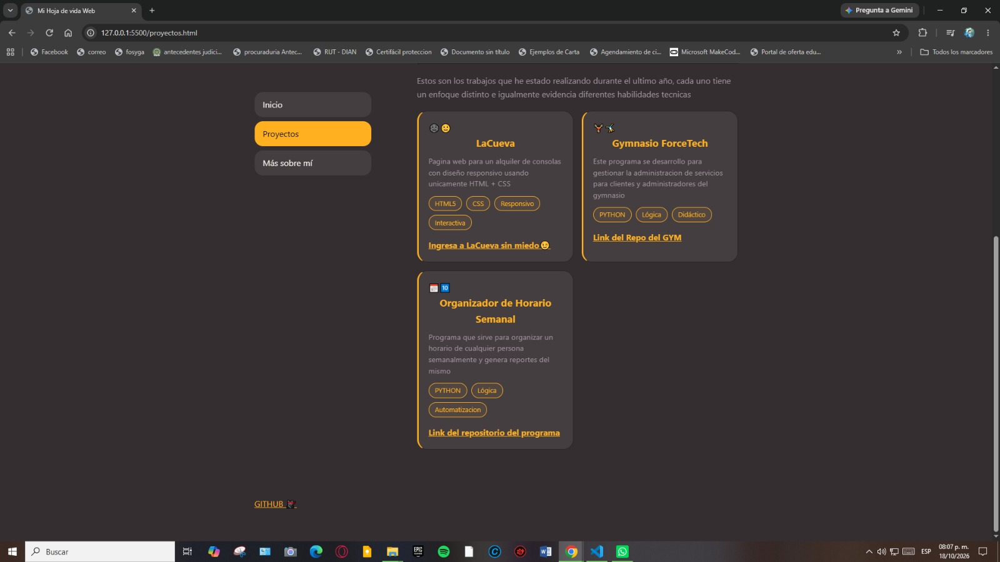

### **Sobre Mi**

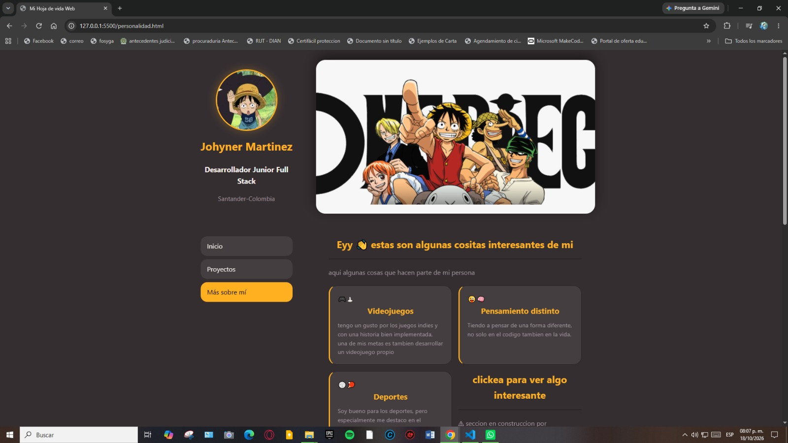
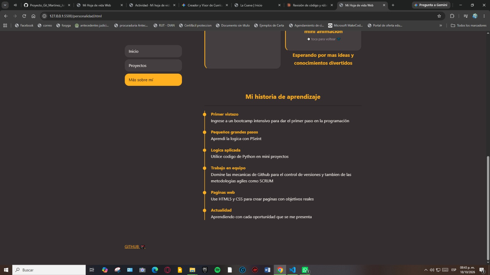


## Cómo lo publiqué
  
<!-- R19 paso a paso de como se publico -->

1. Creé un repositorio **público** en GitHub llamado `Hoja-de-vida`.
2. Subí todos los archivos del sitio (`index.html`, `proyectos.html`, `personalidad.html`, `style.css` y las carpetas `img`, `mockups` y `capturas`).
3. En el repositorio entré a **Settings → Pages**. En **Build and deployment**, en **Source**, elegí **Deploy from a branch**, y luego la rama **main** con la carpeta **/ (root)**. Después pulsé **Save**.
4. Esperé unos minutos hasta que GitHub construyó el sitio. Pude ver el proceso en la pestaña **Actions** y el enlace final en la página de Pages.
5. Abrí el enlace en una ventana de incógnito y desde mi celular para comprobar que las páginas, los enlaces y las imágenes funcionan.
La página principal tiene que llamarse exactamente `index.html` porque es el archivo que GitHub Pages abre por defecto cuando alguien entra al enlace del sitio.

## Fuentes consultadas
 
- Documentación oficial de GitHub: [Configuring a publishing source for your GitHub Pages site](https://docs.github.com/en/pages/getting-started-with-github-pages/configuring-a-publishing-source-for-your-github-pages-site)

- Video tutorial de youtube: [🟢Cómo PUBLICAR un Sitio Web GRATIS con GitHub Pages](https://youtu.be/-qU9OqSnJxY?si=Qdn8mormOZjq4L2k)

- Claude (asistente de IA de Anthropic): lo usé para revisar mi código contra la rúbrica, corregir errores de HTML y de grid y entender los pasos para publicar en GitHub Pages.
